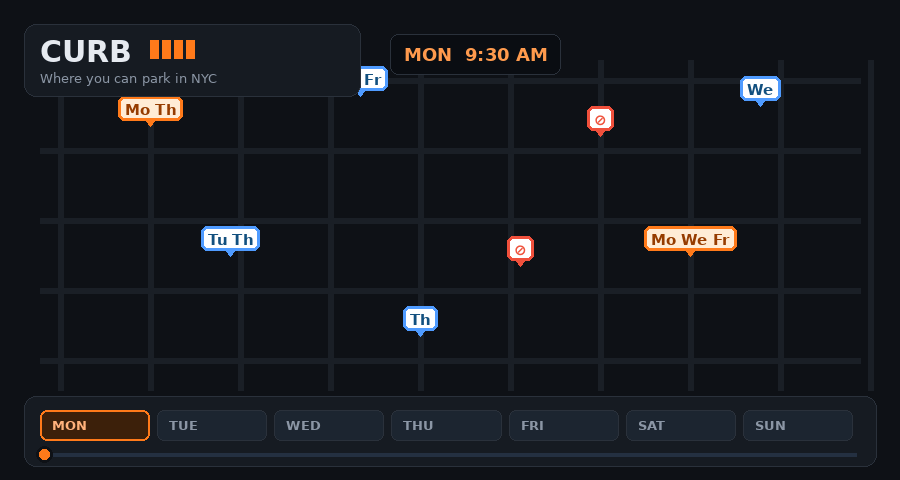

# 🅿️ Curb — where you can park in NYC

**Curb** turns New York City's raw parking-sign data (~88,000 curb segments citywide) into a
live, time-aware map: where you can legally park right now, and when you have to move for
street cleaning.

### ▶️ Live demo: **https://nycityparking.netlify.app/**



---

## ✨ Features

- **Time-aware status** — scrub through the week and watch every curb change color:
  free · free but time-limited · metered · no parking now · street cleaning.
- **Signs view** (default) — small sign icons placed on the correct side of the street,
  showing two-letter cleaning days (`Tu Th`) and a red ⊘ for no-standing/parking anytime.
  Click any sign for that block's full rules.
- **Cleaning filter** — pick the days you want to park; the map keeps only streets with
  **no cleaning** on those days, while each sign still shows the days it *is* cleaned.
- **Magnifier** — an open/close, drag-and-resize loupe for reading dense blocks on mobile.
- **Street-cleaning countdown** — "next cleaning in 3h 20m" per block.
- **Hydrant awareness** — flags curb within 15 ft of a fire hydrant.
- **Day / Night** basemap, collapsible panels, and a phone-friendly layout.
- **Auto-updating** — the server re-downloads NYC data every 24 h (configurable).

---

## 🧠 How it works

```
NYC Open Data ──▶ ingest ──▶ parse signs ──▶ enrich (geo + hydrants) ──▶ blockfaces
                                                                              │
                                          Flask API  ◀── status_at(time) ─────┤
                                                │                             │
                                          MapLibre UI                   static build
                                          (live mode)                   (Netlify mode)
```

1. **Ingest** (`nyc_parking/ingest.py`) pulls two NYC Open Data datasets through the Socrata
   API: *Parking Regulation Locations and Signs* (`nfid-uabd`) and *NYCDEP Citywide
   Hydrants* (`6pui-xhxz`).
2. **Parse** (`nyc_parking/regulations.py`) converts each sign's free text — e.g.
   `NO PARKING (SANITATION BROOM SYMBOL) MONDAY THURSDAY 9AM-10:30AM` — into structured
   rules: category, days, time window, street-cleaning flag.
3. **Enrich** (`nyc_parking/enrich.py`) projects NY State Plane coordinates (EPSG:2263) to
   lat/lon, computes hydrant distance in feet, and groups signs into **blockfaces**
   (one curb segment between two cross-streets, one side of the street).
4. **Serve** (`app.py`) exposes a small JSON API and computes the governing status for any
   moment — the most restrictive active rule wins. The same page also ships a JavaScript
   port of that engine, so it runs with no backend at all on static hosting.

| Mode | When | Data |
|---|---|---|
| **Live** | `python app.py` (Flask) | computed per request, auto-refreshed |
| **Static** | Netlify / any static host | precomputed file + in-browser engine |

**Basemap:** [OpenFreeMap](https://openfreemap.org/) vector tiles — no API key, no account,
no request limits, and sharp at every zoom level. If they're ever unreachable the app falls
back to OpenStreetMap raster tiles automatically.

---

## 🚀 Run it locally

### 1. Install

```bash
git clone <your-repo-url>
cd curb
pip install -r requirements.txt
```

Requires Python 3.9+. Dependencies: Flask, requests, pyproj, scipy, numpy.

### 2. Start the app

```bash
python app.py
```

Open **http://127.0.0.1:5000**.

> Open it through the server — don't double-click `index.html`. The page needs the
> local server to serve its data and assets.

On first launch the app **auto-downloads real NYC data in the background** — Brooklyn
first, then Manhattan, Queens, Bronx, Staten Island — writing after each borough and
refreshing the map as it goes. The panel shows live progress ("Loading Queens…" →
"All NYC data loaded"). Until the first borough lands you'll see a small bundled sample.

### 3. (Optional) API credentials

NYC Open Data works **anonymously**, so you can skip this. A free credential just raises
the rate limit, which helps for the full citywide download. Put it in
`nyc_parking/config.py`:

```python
# Option 1 — classic App Token
NYC_APP_TOKEN = ""

# Option 2 — newer API Key (needs BOTH values; the ID alone will not work)
NYC_API_KEY_ID = ""
NYC_API_KEY_SECRET = ""

# Re-download the data every N hours while the server runs (0 disables)
REFRESH_HOURS = 24
```

Get either at NYC Open Data → *Developer Settings*
(<https://data.cityofnewyork.us/profile/edit/developer_settings>). The **API Key secret is
shown only once** when you create the key — if you missed it, create a new key. If a
credential is ever rejected the app logs it and continues anonymously.

Check access any time:

```bash
python check_api.py
```

---

## 🗽 Download the data for all of New York City

The app does this automatically, but you can run the pipeline yourself:

```bash
# All five boroughs
python -m nyc_parking.pipeline --borough all

# Or a single borough (much faster)
python -m nyc_parking.pipeline --borough Brooklyn
python -m nyc_parking.pipeline --borough Manhattan
python -m nyc_parking.pipeline --borough Queens
python -m nyc_parking.pipeline --borough Bronx
python -m nyc_parking.pipeline --borough "Staten Island"

# Re-process already-downloaded files without hitting the API again
python -m nyc_parking.pipeline --from-cache
```

Everything lands in the **`data/`** folder:

| File | What it is |
|---|---|
| `data/raw/signs_all.json` | raw sign rows straight from the API |
| `data/raw/hydrants.geojson` | raw hydrant points |
| `data/blockfaces.json` | processed curb segments — what the app serves |
| `data/signs_enriched.geojson` | per-sign points with parsed rules + hydrant distance |
| `data/parking.sqlite` | the same data in SQLite, for querying |

Citywide is a large pull (hundreds of thousands of signs), so expect several minutes.
The app prefers `data/*.json` over the bundled sample automatically. If the server is
already running, load the new data without restarting:

```
http://127.0.0.1:5000/api/reload
```

Useful endpoints while it runs:

| Endpoint | Purpose |
|---|---|
| `/api/status` | download progress as JSON |
| `/api/load?force=1` | force a fresh re-download |
| `/api/reload` | re-read data files from disk |
| `/api/meta` | current mode + record counts |

---

## 🏗️ Build and deploy (static)

Static hosts don't run Flask, so the build precomputes the data and ships the in-browser
engine:

```bash
python -m nyc_parking.pipeline --borough Brooklyn   # 1) get data
python build_static.py                              # 2) writes ./dist
```

`./dist` is a self-contained site (page + map library + data). Deploy it anywhere:

```bash
npx netlify-cli deploy --dir=dist --prod
```

…or drag the `dist` folder onto <https://app.netlify.com/drop>. `netlify.toml` already sets
`publish = "dist"`.

A static site is a **snapshot** — re-run the pipeline and `build_static.py`, then redeploy,
to refresh it. Citywide data makes a large download for visitors, so a single borough keeps
a public site light.

---

## 🧪 Tests

```bash
python -m tests.test_regulations   # sign parser + status engine
python demo_offline.py             # full pipeline on a fixture, no network
```

---

## 📁 Project structure

```
curb/
├── app.py                     # Flask server: API, background loader, auto-refresh
├── build_static.py            # builds ./dist for static hosting
├── check_api.py               # diagnoses NYC Open Data access / credentials
├── make_sample.py             # regenerates the bundled sample dataset
├── demo_offline.py            # runs the pipeline logic on a fixture (no network)
├── netlify.toml               # static deploy config
├── requirements.txt
│
├── nyc_parking/               # the data pipeline (pure Python, tested)
│   ├── config.py              # credentials + refresh interval
│   ├── ingest.py              # Socrata download (auth, paging, retries)
│   ├── regulations.py         # sign-text parser + status engine
│   ├── enrich.py              # projection, hydrant join, blockface grouping
│   └── pipeline.py            # orchestrates ingest → enrich → output
│
├── templates/
│   └── index.html             # the whole front end (map, UI, in-browser engine)
├── static/vendor/             # MapLibre GL JS/CSS, bundled (no CDN needed)
├── data/
│   └── sample/                # small sample so it runs before any download
├── docs/
│   ├── demo.gif               # README demo
│   └── make_demo_gif.py       # regenerates the demo GIF
└── tests/
    └── test_regulations.py    # parser + status unit tests
```

---

## 🗺️ Data & credits

- Parking rules: [NYC DOT — Parking Regulation Locations and Signs](https://data.cityofnewyork.us/Transportation/Parking-Regulation-Locations-and-Signs/nfid-uabd)
- Hydrants: [NYCDEP Citywide Hydrants](https://data.cityofnewyork.us/Environment/NYCDEP-Citywide-Hydrants/6pui-xhxz)
- Rendering: [MapLibre GL JS](https://maplibre.org/) · basemap [OpenFreeMap](https://openfreemap.org/)
  · map data © [OpenStreetMap](https://www.openstreetmap.org/copyright) contributors

## ⚠️ Notes & roadmap

- Each block renders at one point; splitting a blockface into exact curb spans using the
  sign **arrows** is the next milestone.
- Sign coordinates approximate the curb point — a good hydrant flag, not survey-grade.
- **No real-time occupancy.** Whether a specific spot currently has a car in it is in no
  dataset and cannot be derived from satellite imagery.
- Always obey the posted signs. This is an informational tool, not legal advice.

## 📝 License

MIT. Data belongs to the City of New York.
